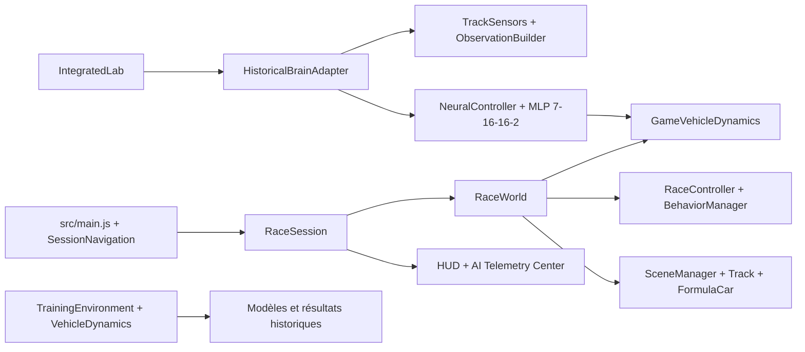

<div align="center">

# NeuroDriveAI V2 — F1 Ultimate Edition

**3D Racing · Steering Behaviors · Neural Networks · Scientific AI Labs**

An interactive JavaScript and Three.js project combining an F1-style arcade racing experience with educational simulations and historical neural-network experiments.


[Features](#fonctionnalités) · [Architecture](#architecture) · [Installation](#prérequis-et-installation) · [Research](#réseaux-neuronaux-et-résultats-scientifiques) · [Academic context](#auteur-et-contexte)

</div>

## Project at a glance

| Area | What the repository demonstrates |
| :--- | :--- |
| **3D game development** | Interactive F1-style racing, cameras, HUD, tracks, and car dynamics |
| **Autonomous behaviors** | Path following, obstacle avoidance, separation, and pursuit |
| **Neural networks** | Historical MLP models (7–16–16–2), observations, activations, and control outputs |
| **Educational tooling** | Steering Lab, Neural Lab, Circuit Studio, and guided professor demonstration |
| **Engineering** | ES modules, modular architecture, automated tests, and a GitHub Pages deployment workflow |

> **Scope:** This is an educational project. Arcade gameplay and historical scientific experiments have distinct dynamics and validation protocols; gameplay is not evidence of scientific generalization.

### Quick start (English)

Requires Node.js compatible with Vite 7 and npm.

```bash
git clone https://github.com/mohamed-yawina/NeuroDriveAI-V2.git
cd NeuroDriveAI-V2
npm ci
npm run dev
```

Open the local URL printed by Vite. Run `npm test` for the Vitest suite or `npm run build` to produce a distributable build.

**CI/CD:** The repository includes `.github/workflows/deploy.yml`, configured to run `npm ci`, tests, build, and GitHub Pages deployment on pushes to `main`. The presence of this workflow does not by itself confirm a successful deployment.

**Research note:** Scientific training and recovery scripts can write result artifacts; they are **not** needed to start the game. Consult the French research documentation before running them.

---

## Documentation détaillée (français)

## Objectifs pédagogiques

- Comprendre comment une force de direction est construite à partir d’une vitesse souhaitée et de la vitesse actuelle.
- Observer Path Following, obstacle avoidance, séparation et leur combinaison.
- Examiner les observations, activations et sorties d’un MLP 7→16→16→2.
- Distinguer l’expérience scientifique historique d’une partie de démonstration arcade.
- Étudier les choix d’architecture, la reproductibilité, les tests et les limites des résultats.

## Fonctionnalités

- **Course rapide** : six voitures, conduite clavier, contrôleurs Steering, classement, chronométrage, caméras et mini-carte.
- **Carrière locale** : saison et résultats sauvegardés localement, avec points issus des courses terminées.
- **Garage** : quatre silhouettes esthétiques de monoplaces, couleurs, numéro, nom et profil pilote.
- **Circuit Studio** : modèles, dessin libre, validation, brouillons et bibliothèque de circuits. Les circuits invalides ne sont pas proposés en course.
- **Steering Lab** : session F1 partagée avec vecteurs Steering publiés par les contrôleurs, paramètres disponibles et AI Telemetry Center.
- **Neural Lab** : sessions F1 avec Steering AI et les vrais modèles historiques A/B/C; observations, activations, sorties et adaptation arcade affichées séparément.
- **Mode Professeur** : parcours guidé de 180 secondes, étape par étape, avec pause, reprise, navigation manuelle et script oral.
- **Audio et accessibilité** : musique REDLINE limitée aux menus, sons de course, réglages audio, profils graphiques, moniteur FPS facultatif et haptique lorsqu’elle est prise en charge.

Les effets visuels, la météo, les avatars et les variantes de carrosserie n’altèrent pas les résultats expérimentaux. Le turbo est une mécanique arcade; il est désactivé dans les laboratoires IA.

## Steering Behaviors

Le jeu F1 utilise un sous-ensemble des comportements : Path Following, Obstacle Avoidance et Separation; Pursuit est activé conditionnellement par le planificateur de dépassement. Seek sert notamment au calcul de la force de suivi de cible. Flee, Arrive, Evade, Wander, Alignment, Cohesion et Leader Following sont disponibles dans les scénarios pédagogiques, mais ne sont pas tous des contrôleurs actifs de course F1.

Les forces sont calculées et pondérées par `BehaviorManager`, puis la résultante est plafonnée à `maxForce`. Le gestionnaire applique une somme pondérée, pas un système de priorités. Voir [`docs/steering-behaviors-audit.md`](docs/steering-behaviors-audit.md) et [`docs/phase10-steering-academy.md`](docs/phase10-steering-academy.md).

## Réseaux neuronaux et résultats scientifiques

Les artefacts historiques A/B/C utilisent l’architecture MLP `7–16–16–2` et sont servis depuis `public/phase8-model-{a,b,c}.json`. Le vecteur d’observation est formé de cinq distances de capteurs normalisées, d’un ratio de vitesse et d’une erreur de cap normalisée. Les sorties bornées représentent le braquage et la commande longitudinale accélération/freinage. Le Neural Lab les adapte au moteur arcade; ces parties ne reproduisent pas automatiquement les conditions physiques historiques.

Les protocoles, métriques brutes, interprétations et limites sont décrits dans :

- [`docs/scientific-methodology.md`](docs/scientific-methodology.md) — séparation des moteurs et méthodologie.
- [`docs/scientific-validation.md`](docs/scientific-validation.md) — validation phase 4 et limites.
- [`docs/multitrack-training.md`](docs/multitrack-training.md) — phase 7 multi-circuits.
- [`docs/phase8-configuration-b.md`](docs/phase8-configuration-b.md) et [`docs/phase8-configuration-c.md`](docs/phase8-configuration-c.md) — configurations B/C, validations et test réservé.
- [`docs/generalization-validation.md`](docs/generalization-validation.md) — généralisation et incertitudes.

La validation phase 4 consignée dans la documentation couvre 250 générations × 16 candidats × 3 graines, soit 12 000 épisodes. Les terminaisons incluent des sorties de piste, des blocages et des limites de temps; une fitness élevée seule ne démontre donc pas un pilotage robuste. En phase 8, C termine 267/270 essais sur les trois circuits connus décrits et 60/90 sur le circuit final réservé; une graine C obtient 0/30 sur ce test. Ces échantillons limités ne démontrent pas une généralisation universelle ou une supériorité statistique.

Les poids et résultats historiques ne sont pas modifiés par les modes arcade. Aucun entraînement n’est lancé au démarrage de l’application, par `npm.cmd test` ou par `npm.cmd run build`. Les scripts `train:*` et `recover:*` peuvent écrire des artefacts de résultats; ne les lancez pas pour une démonstration.

## Architecture



Les responsabilités des modules, les frontières de données et le cycle de vie sont détaillés dans [`docs/architecture-overview.md`](docs/architecture-overview.md).

## Technologies

- JavaScript ES Modules.
- Three.js pour le rendu WebGL.
- Vite pour le serveur de développement et le build.
- Vitest pour les tests unitaires, déterministes et d’intégration headless.
- Web Audio API et Gamepad/Vibration API si le navigateur et le matériel les exposent.

Les seules dépendances directes déclarées sont `three` et, pour le développement, `vite` et `vitest`.

## Prérequis et installation

Node.js 20.19+ ou 22.12+ et npm (version requise par Vite 7). Sous Windows :

```powershell
npm.cmd install
npm.cmd run dev
```

Ouvrez l’URL locale indiquée par Vite. Le projet n’exige pas de service en ligne pour démarrer. Le premier geste utilisateur peut être nécessaire pour autoriser l’audio dans le navigateur.

## Commandes

| Commande | Fonction |
|---|---|
| `npm.cmd run dev` | Serveur Vite de développement |
| `npm.cmd test` | Suite Vitest complète |
| `npm.cmd run build` | Build de production |
| `npm.cmd run preview` | Prévisualiser le build Vite |
| `npm.cmd run validate:training` | Lancer la validation scientifique phase 4; écrit des résultats |
| `npm.cmd run validate:generalization` | Rejouer l’évaluation documentée de généralisation |
| `npm.cmd run train:multitrack` | Entraînement multi-circuits; écrit des artefacts |
| `npm.cmd run train:phase8-b` / `train:phase8-c` | Lancer les entraînements B/C; opérations longues et persistantes |
| `npm.cmd run validate:phase8-b` / `validate:phase8-abc` | Valider les modèles existants sans les réentraîner |
| `npm.cmd run test:phase8-heldout` / `test:phase8-c-heldout` | Lancer les scripts de test final documentés |
| `npm.cmd run export:phase8-ai-lab` | Exporter les artefacts de présentation A/B/C |
| `npm.cmd run recover:phase8-c` | Reprise/rejeu contrôlé de C; écrit un nouvel artefact |

Consultez la documentation de chaque protocole avant les commandes scientifiques. Elles ne sont pas requises pour lancer le jeu ou vérifier le build.

## Commandes en course

| Action | Commande |
|---|---|
| Accélérer / marche arrière | `↑` ou `W` / `↓` ou `S` |
| Freiner | `↓` ou `S` |
| Tourner | `←`/`A` et `→`/`D` |
| Pause / reprise | `Espace` |
| Changer de caméra | `C` |
| Regard arrière temporaire | maintenir `B` |
| Recommencer | `R` |
| Suivre une voiture | `1`–`6` ou le sélecteur du HUD |
| Rapport manuel, si mécaniques arcade activées | `Q` / `E` |
| DRS, si disponible dans cette course | `F` |
| ERS, si disponible dans cette course | `V` |
| Turbo arcade | maintenir `Shift`; non disponible dans les laboratoires IA |
| Mode HUD | `H` |

Les touches maintenues sont effacées lors de la perte de focus. Le tutoriel interactif indique également ses commandes selon l’étape.

## Démonstration universitaire

- **Mode Professeur** : depuis Carrière locale, ouvre le parcours guidé. Il distingue les mesures de course des données de recherche et la chronologie prend environ trois minutes sans pause ni délai de chargement.
- **Circuit Studio** : créez ou modifiez une définition de piste, sauvegardez un brouillon, validez puis testez la géométrie valide dans le moteur F1 partagé.
- **Guide 5 minutes** : [`docs/final-demo-guide.md`](docs/final-demo-guide.md).
- **Questions de soutenance** : [`docs/professor-questions-answers.md`](docs/professor-questions-answers.md).
- **Audit académique** : [`docs/modification-28-final-academic-audit.md`](docs/modification-28-final-academic-audit.md).

## Captures

Aucune capture d’écran du jeu validée visuellement n’est incluse actuellement. Le wireframe de conception est une référence d’interface, pas une capture du produit; il se trouve dans `docs/design/NeuroDrive F1 3D Wireframes.pdf`.

## Auteur et contexte

Projet de Simo pour le Master IA2 Casablanca G1, promotion 2026–2027; support de cours de Michel Buffa. Le code et les résultats décrivent l’état du dépôt. La conformité officielle à une consigne de rendu ou à un barème doit être confirmée à partir des consignes remises à la promotion.
