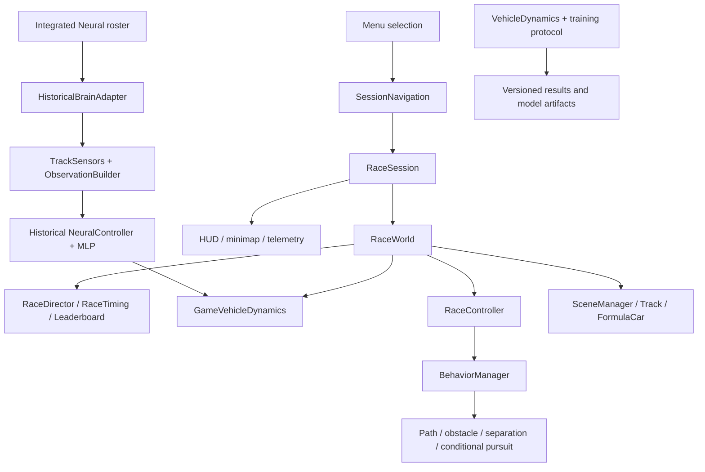

# Architecture overview

## Application layers

| Layer | Main modules | Responsibility |
|---|---|---|
| Browser shell and menu | `index.html`, `src/main.js`, `src/ui/MainMenuSections.js` | Mounts the Racing Red menu and dispatches user selections to existing modes. |
| Session lifecycle | `src/ui/SessionNavigation.js` | Owns `menu → loading → simulation → closing → menu`, creates one session, awaits disposal before reopening the menu. |
| F1 arcade session | `src/game/RaceSession.js` | Connects keyboard, HUD, audio, settings, cameras, Three.js scene, race world and mode-specific panels. |
| Race rules and simulation | `RaceWorld`, `RaceDirector`, `RaceTiming`, `RaceLeaderboard` | Fixed-step race updates, starts, lap validation, ranking, collisions and finish state. |
| Arcade physics and AI | `GameVehicleDynamics`, `GameCar`, `RaceController`, `BehaviorManager`, `OvertakingPlanner` | Human arcade controls and autonomous F1 Steering controllers. This layer does not replace the historical scientific engine. |
| Rendering | `src/scene/SceneManager.js`, `Track.js`, `FormulaCar.js`, `RaceCameras.js` | Three.js scene, shared track definition, car meshes, scenery, cameras, resize and GPU resource cleanup. |
| Integrated AI labs | `src/neural-lab/IntegratedLab.js`, `RaceSession.mountIntegratedLabPanel`, `RaceLabVisuals`, `AITelemetryCenter` | Assigns controllers to the F1 roster and displays the actual selected car’s diagnostics. Labs use the same `RaceSession` and `RaceWorld`. |
| Circuit editing | `src/circuits/CircuitStudio.js`, `CircuitFormat.js`, `CircuitValidator.js`, `CircuitLibrary.js` | Creates versioned track definitions, validates them and persists user tracks. Valid definitions are consumed by the normal race track builder. |
| Local persistence | `CareerStore.js`, `CircuitLibrary.js`, user preferences | Stores local career, course progress, user circuits and settings. This is browser-local storage, not account sync. |
| Scientific/research runtime | `src/physics/VehicleDynamics.js`, `src/ai/training/`, `src/neural-lab/ExperimentProtocol.js` | Historical physics, training/evaluation environments and versioned evaluation adapters. These modules are separate from game rendering and career scoring. |

## Main data paths

The F1 game may visualize a historical network through `HistoricalBrainAdapter`, but that adapter deliberately uses `GameVehicleDynamics`, arcade bounds and the live game cadence. It is therefore a demonstration path, not the historical evaluation protocol.

## Session and resource lifecycle

1. `SessionNavigation.launch()` changes state to `loading` and awaits creation of one session.
2. `RaceSession` creates the Three.js scene, race world, car views, cameras, event listeners and an animation loop.
3. On exit, `returnToMenu()` enters `closing`, awaits `RaceSession.dispose()` and only then returns to `menu`.
4. Session disposal cancels the animation frame, aborts event listeners, stops audio/haptics, disposes scene-owned geometries/materials/renderers and removes the HUD.
5. The menu showroom is reactivated only after the session lifecycle changes back to `menu`.

Laboratory stages in the Mode Professeur reuse a live session while its lab type stays the same. Only a Steering ↔ Neural change closes and opens a new session.

## Scientific boundaries

- `VehicleDynamics` integrates the research vehicle and historical controller contract; it does not import F1 career or Turbo systems.
- `GameVehicleDynamics` belongs to arcade racing. Its mass, speed bounds, collision rules, braking and turbo are gameplay settings.
- `HistoricalBrainAdapter` supplies current game observations to a frozen A/B/C model and converts outputs to arcade forces. Do not mix its race outcome with a saved historical fitness value.
- `CareerStore` only receives eligible completed game races. Integrated lab sessions opt out of career persistence.
- Training, held-out evaluation and export scripts are explicit commands and may write outputs. Normal app startup, tests and production build do not invoke those scripts.

## Build and test layout

- `src/`: browser application, game, rendering, AI, scientific utilities and persistence.
- `public/phase8-model-*.json`: served model artifacts A/B/C.
- `results/`: research outputs and checkpoints; treat historical files as immutable evidence.
- `docs/`: protocols, phase reports, course mapping and release documentation.
- `tests/`: Vitest unit, deterministic simulation and integration tests.

Vite emits a warning for the Three.js chunk above its default 500 kB minified-size warning threshold. This is a bundle-size warning; it is not an FPS measurement.
